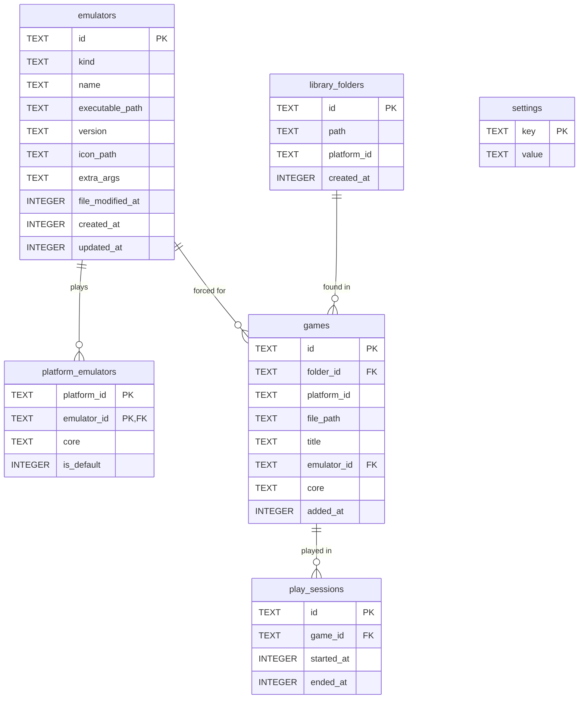

# Database

Ilnamiki keeps the user's data in a single SQLite database. This document explains its
structure: what each table is for, what each field means and how tables relate.

- **Source of truth:** the migrations in `src/main/core/database/migrations/`. If this
  document and the migrations disagree, the migrations are right.
- **Rules for changing it:** the `main-database` skill. Every migration updates this document
  in the same change.
- This document describes structure only, never real data.

## Overview

| | |
|---|---|
| Engine | SQLite 3, through `node:sqlite` (built into Electron; no dependency) |
| Used by | The main process only. The renderer reads and changes data through `window.api` |
| File | `ilnamiki.db` in the app's user data folder (`~/.config/ilnamiki/` on Linux) |
| Journal | WAL (`ilnamiki.db-wal` and `ilnamiki.db-shm` exist while the app runs) |
| Foreign keys | Enforced on every connection |
| Schema version | Kept in `PRAGMA user_version`; the number of the last migration applied |
| Current version | **0**: no tables yet |

## What is stored and what isn't

| Stored in the database | Kept another way |
|---|---|
| What the user sets up or chooses (emulators, which emulator plays each platform, folders to scan, preferences) | **Live system state**, read when needed: installed emulator cores, whether files exist, connected hardware |
| History that can't be rebuilt (play sessions, when things were added) | **Static catalogs, in code**: platforms and their details, known emulators and how to launch them. The database stores only their ids |
| Caches of slow work, with what tells when they're stale (scan results, what was detected about an emulator file) | **Binary content, as files** in the app's data folder: artwork, icons. The database stores their path |
| Data that is searched, sorted or related (the game library) | **Derived values, computed by queries**: total playtime, last played, counts |
| | **Secrets**: never stored; the system keychain if ever needed |

## Conventions

| Kind of field | Type | Rule |
|---|---|---|
| Id | `TEXT PRIMARY KEY` | A UUID created in main (`crypto.randomUUID()`); catalog ids (platforms) are their stable string ids |
| Timestamp | `INTEGER` | Milliseconds since the epoch, named `*_at` |
| Boolean | `INTEGER` | `0` or `1`, checked; named as a question (`is_default`) |
| Closed set | `TEXT` | One of a checked list that matches the API's string union |
| JSON | `TEXT` | Checked with `json_valid`; only for data whose shape is open |
| Path | `TEXT` | Absolute, exactly as the system gives it |

All tables are `STRICT`, names are `snake_case`, columns are `NOT NULL` unless a field says
what its `NULL` means, and every foreign key states what happens when its row is deleted.

## Tables

None yet. Each table gets a section here, with its fields, when its migration is added.

## Planned tables

A first draft of where the schema is heading, so each migration fits the next. **None of
these exist yet**: each one is designed for real, and may change, when the feature that needs
it is built, and moves to [Tables](#tables) once its migration exists.

### `emulators` (planned)

The emulators the user added.

| Field | Type | Null | Meaning |
|---|---|---|---|
| `id` | `TEXT` | no | Primary key |
| `kind` | `TEXT` | no | Which known emulator it is (`retroarch`), or `custom` when it isn't recognized |
| `name` | `TEXT` | no | Name shown in the app; detected, then editable by the user |
| `executable_path` | `TEXT` | no | Absolute path to the emulator's application (e.g. an AppImage) |
| `version` | `TEXT` | yes | Version detected from the application; `NULL` when it couldn't be read |
| `icon_path` | `TEXT` | yes | The emulator's icon, copied into the app's data folder; `NULL` without one |
| `extra_args` | `TEXT` | yes | Command-line arguments the user adds to the known ones; `NULL` for none |
| `file_modified_at` | `INTEGER` | yes | When the application file was last modified at detection; a different value means it must be detected again |
| `created_at` | `INTEGER` | no | When it was added |
| `updated_at` | `INTEGER` | no | When it last changed |

### `platform_emulators` (planned)

Which emulator, and which core of it, plays each platform.

| Field | Type | Null | Meaning |
|---|---|---|---|
| `platform_id` | `TEXT` | no | Platform from the app's catalog (e.g. `nintendo_64`) |
| `emulator_id` | `TEXT` | no | → `emulators.id`; deleting the emulator removes its rows here |
| `core` | `TEXT` | yes | Core to load for multi-system emulators (e.g. `mupen64plus_next`); `NULL` for emulators without cores |
| `is_default` | `INTEGER` | no | Whether it is the one used when a game doesn't choose; one per platform |

Primary key: (`platform_id`, `emulator_id`).

### `library_folders` (planned)

Folders the user wants scanned for games.

| Field | Type | Null | Meaning |
|---|---|---|---|
| `id` | `TEXT` | no | Primary key |
| `path` | `TEXT` | no | Absolute path of the folder; unique |
| `platform_id` | `TEXT` | yes | Platform all its games belong to; `NULL` to tell each game's platform from its file |
| `created_at` | `INTEGER` | no | When it was added |

### `games` (planned)

The games found in the library folders.

| Field | Type | Null | Meaning |
|---|---|---|---|
| `id` | `TEXT` | no | Primary key |
| `folder_id` | `TEXT` | no | → `library_folders.id`; removing the folder removes its games |
| `platform_id` | `TEXT` | no | Platform from the app's catalog |
| `file_path` | `TEXT` | no | Absolute path of the game file; unique |
| `title` | `TEXT` | no | Title shown in the app |
| `emulator_id` | `TEXT` | yes | → `emulators.id`; emulator forced for this game, `NULL` to use the platform's default. Deleting the emulator sets it back to `NULL` |
| `core` | `TEXT` | yes | Core forced for this game; `NULL` to use the platform's |
| `added_at` | `INTEGER` | no | When it was found |

Metadata (description, genre, year, players, artwork paths) will be added when the source of
that metadata is decided.

### `play_sessions` (planned)

Each time a game was played. Rows are only added, never changed; total playtime and last
played are computed from them.

| Field | Type | Null | Meaning |
|---|---|---|---|
| `id` | `TEXT` | no | Primary key |
| `game_id` | `TEXT` | no | → `games.id`; removing the game removes its sessions |
| `started_at` | `INTEGER` | no | When the emulator was launched |
| `ended_at` | `INTEGER` | no | When it closed |

### `settings` (planned)

App preferences, one row each.

| Field | Type | Null | Meaning |
|---|---|---|---|
| `key` | `TEXT` | no | Primary key: the preference's name (e.g. `language`) |
| `value` | `TEXT` | no | Its value as JSON |
