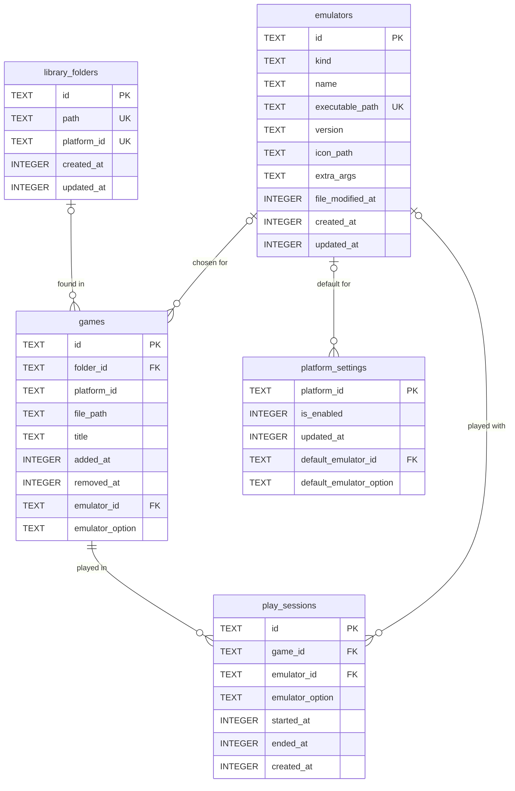
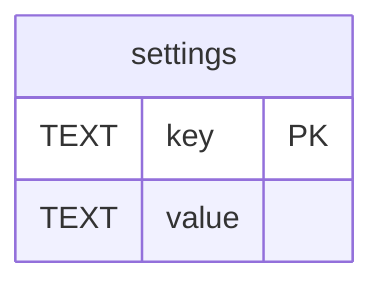

# Database

Ilnamiki keeps the user's data in a single SQLite database. This document explains its
structure: what each table is for, what each field means and how tables relate.

- **Source of truth:** the migrations in `src/main/core/database/migrations/`. If this
  document and the migrations disagree, the migrations are right.
- **Rules for changing it:** the `main-database` skill. Every migration updates this document
  in the same change.
- This document describes structure only, never real data.

## Overview

| | |
|---|---|
| Engine | SQLite 3, through `node:sqlite` (built into Electron; no dependency) |
| Used by | The main process only. The renderer reads and changes data through `window.api` |
| File | `ilnamiki.db` in the app's user data folder (`~/.config/ilnamiki/` on Linux) |
| Journal | WAL (`ilnamiki.db-wal` and `ilnamiki.db-shm` exist while the app runs) |
| Foreign keys | Enforced on every connection |
| Schema version | Kept in `PRAGMA user_version`; the number of the last migration applied |
| Current version | **5**: `emulators`, `library_folders`, `games`, `play_sessions`, `platform_settings` |

## What is stored and what isn't

| Stored in the database | Kept another way |
|---|---|
| What the user sets up or chooses (emulators, which emulator plays each platform, folders to scan, preferences) | **Live system state**, read when needed: the options each emulator has, whether files exist, connected hardware |
| History that can't be rebuilt (play sessions, when things were added) | **Static catalogs, in code**: platforms and their details, known emulators and how to launch them. The database stores only their ids |
| Caches of slow work, with what tells when they're stale (scan results, what was detected about an emulator file) | **Binary content, as files** in the app's data folder: artwork, icons. The database stores their path |
| Data that is searched, sorted or related (the game library) | **Derived values, computed by queries**: total playtime, last played, counts |
| | **Secrets**: never stored; the system keychain if ever needed |

## Conventions

| Kind of field | Type | Rule |
|---|---|---|
| Id | `TEXT PRIMARY KEY` | A UUID created in main (`crypto.randomUUID()`); catalog ids (platforms) are their stable string ids |
| Timestamp | `INTEGER` | Milliseconds since the epoch, named `*_at` |
| Boolean | `INTEGER` | `0` or `1`, checked; named as a question (`is_default`) |
| Closed set | `TEXT` | One of a checked list that matches the API's string union |
| JSON | `TEXT` | Checked with `json_valid`; only for data whose shape is open |
| Path | `TEXT` | Absolute, exactly as the system gives it |

All tables are `STRICT`, names are `snake_case`, columns are `NOT NULL` unless a field says
what its `NULL` means, and every foreign key states what happens when its row is deleted.

## Tables

### `emulators`

Migration 1. The emulators the user added. What is detected about the application (kind,
version, icon) is a cache: it is read when the emulator is added.

| Field | Type | Null | Meaning |
|---|---|---|---|
| `id` | `TEXT` | no | Primary key |
| `kind` | `TEXT` | no | Which known emulator it is: `retroarch`, `eden`, or `unknown` when Ilnamiki doesn't recognize it |
| `name` | `TEXT` | no | Name shown in the app, never empty: detected from the application's desktop entry, then editable by the user |
| `executable_path` | `TEXT` | no | Absolute path to the emulator's application (an AppImage for now); unique, so an application is added once |
| `version` | `TEXT` | yes | Version the application reports (e.g. `1.22.2`); `NULL` when it reports none or isn't recognized |
| `icon_path` | `TEXT` | yes | The application's icon, copied to `emulators/icons/<id>.<svg\|png>` in the app's data folder; `NULL` without one |
| `extra_args` | `TEXT` | yes | Command-line arguments the user adds to the known ones; `NULL` for none (not used yet) |
| `file_modified_at` | `INTEGER` | yes | When the application file was last modified, at detection; a different value means it changed and should be detected again |
| `created_at` | `INTEGER` | no | When it was added |
| `updated_at` | `INTEGER` | no | When it last changed |

### `library_folders`

Migration 2. The folders the user added for Ilnamiki to find games in. Each one holds the
games of one platform, and each platform has one folder at most.

| Field | Type | Null | Meaning |
|---|---|---|---|
| `id` | `TEXT` | no | Primary key |
| `path` | `TEXT` | no | Absolute path of the folder; unique |
| `platform_id` | `TEXT` | no | Platform its games belong to (e.g. `playstation`); unique, so a platform has one folder |
| `created_at` | `INTEGER` | no | When it was added |
| `updated_at` | `INTEGER` | no | When it last changed |

Whether the folder is still on disk isn't stored: it is checked when the folders are read.

### `games`

Migration 2. The playable games found in the library folders, saved as the scan the user
saw found them; damaged games (e.g. a cue sheet whose tracks are missing) aren't saved.
Games are never deleted: removing one marks it removed, so its history stays and comes back
if the same file is added again.

| Field | Type | Null | Meaning |
|---|---|---|---|
| `id` | `TEXT` | no | Primary key; kept when a removed game comes back |
| `folder_id` | `TEXT` | yes | → `library_folders.id`; `NULL` exactly when the game is removed. A folder can't be deleted while games are in it (`RESTRICT`): its games are marked removed first |
| `platform_id` | `TEXT` | no | Platform it belongs to, as its folder's when it was found |
| `file_path` | `TEXT` | no | Absolute path of the file the emulator opens (e.g. a `.cue` or `.m3u`, not its tracks) |
| `title` | `TEXT` | no | Title shown in the app, never empty: the file's name without its extension, for now |
| `added_at` | `INTEGER` | no | When it was first found |
| `removed_at` | `INTEGER` | yes | When it was removed (e.g. with its folder); `NULL` while it is in a folder |
| `emulator_id` | `TEXT` | yes | Migration 5. → `emulators.id`: the emulator the user chose for this game; `NULL` while they chose none. Deleting the emulator sets it back to `NULL` (`SET NULL`) |
| `emulator_option` | `TEXT` | yes | Migration 5. Which of the chosen emulator's options plays the game (e.g. `snes9x`, a RetroArch core), never empty; `NULL` for an emulator without options. Read only while `emulator_id` is set |

Unique: (`platform_id`, `file_path`), which is how a removed game is recognized when it comes
back. A `CHECK` keeps `folder_id` and `removed_at` consistent: exactly one of them is set.
Index: `games_folder_id_index`, to list and count a folder's games.

### `play_sessions`

Migration 3. Each time a game was played, from when its emulator started until it closed,
however it closed. A game open less than 10 seconds doesn't count and isn't saved. Rows are
only added, never changed; whether a game was played, when it was last played and its total
playtime are computed from them. A session is saved when the emulator closes, so one in
progress when Ilnamiki itself closes is lost.

| Field | Type | Null | Meaning |
|---|---|---|---|
| `id` | `TEXT` | no | Primary key |
| `game_id` | `TEXT` | no | → `games.id`. Games are never deleted (only marked removed), so a game's sessions stay and show again when it comes back; a played game can't be deleted (`RESTRICT`) |
| `emulator_id` | `TEXT` | yes | → `emulators.id`: the emulator it was played with; `NULL` once that emulator is deleted (`SET NULL`), the session staying |
| `emulator_option` | `TEXT` | yes | Which of the emulator's options it was played with (e.g. `mupen64plus_next`), never empty; `NULL` for an emulator without options |
| `started_at` | `INTEGER` | no | When the emulator started |
| `ended_at` | `INTEGER` | no | When it closed; never before `started_at` (`CHECK`) |
| `created_at` | `INTEGER` | no | When the session was saved, so rows keep the order they were added in |

Indexes: `play_sessions_game_id_index`, to sum and date a game's sessions;
`play_sessions_ended_at_index`, to find the game played last.

### `platform_settings`

Migration 4. What the user set for a platform. Only platforms the user changed have a row:
a platform without one is on, so a platform that appears when an emulator starts playing it
starts on without anything being written. Platforms themselves aren't stored; they are read
live from the emulators. While a platform is off, its games are left out of the library, Home
and random picks; nothing about them is deleted.

| Field | Type | Null | Meaning |
|---|---|---|---|
| `platform_id` | `TEXT` | no | Primary key: the platform's id as the emulators and the platform catalog name it (e.g. `nintendo_64`), never empty |
| `is_enabled` | `INTEGER` | no | Whether the platform is on: `0` or `1` (`CHECK`) |
| `updated_at` | `INTEGER` | no | When the user last changed it |
| `default_emulator_id` | `TEXT` | yes | Migration 5. → `emulators.id`: the emulator the platform's games play with; `NULL` while the user chose none. Deleting the emulator sets it back to `NULL` (`SET NULL`) |
| `default_emulator_option` | `TEXT` | yes | Migration 5. Which of that emulator's options the platform's games play with (e.g. `bsnes`), never empty; `NULL` for an emulator without options. Read only while `default_emulator_id` is set |

Neither table checks the option against its emulator: an option's meaning is known only to
the emulator's module, and deleting an emulator clears only the emulator, so an option left
alone is read as no choice.

### Which emulator a game plays with

Computed when a game is shown or started, never stored, from these in order; an emulator (or
option) that doesn't play the platform anymore is passed over for the next:

1. The emulator chosen for the game (`games.emulator_id`, `games.emulator_option`).
2. The emulator of its latest session with an emulator the user still has (`play_sessions`),
   so it finds its progress: save states only load in the emulator that made them, and
   RetroArch may keep saves apart by option (when set to sort them by core).
3. The emulator chosen for its platform (`platform_settings.default_emulator_id`,
   `default_emulator_option`).
4. Its platform's first emulator, by emulator name and then option name.

## Planned tables

A first draft of where the schema is heading, so each migration fits the next. **None of
these exist yet**: each one is designed for real, and may change, when the feature that needs
it is built, and moves to [Tables](#tables) once its migration exists. The emulators chosen
for platforms and games, first planned as a `platform_emulators` table and columns of `games`,
were built in migration 5 (see `platform_settings` and `games` above).

Metadata of `games` (description, genre, year, players, artwork paths) will be added when the
source of that metadata is decided.

### `settings` (planned)

App preferences, one row each.

| Field | Type | Null | Meaning |
|---|---|---|---|
| `key` | `TEXT` | no | Primary key: the preference's name (e.g. `language`) |
| `value` | `TEXT` | no | Its value as JSON |
